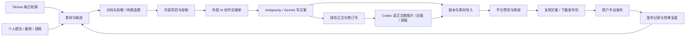

# 个人自媒体工作台 PRD

版本：v1.2 需求稿（含对话自动入库、对标与拆解）
日期：2026-10-10（Asia/Shanghai）
使用者：个人创作者
实施工具：Antigravity
部署范围：本机运行、本地保存
交付目标：可持续使用的内容工作台

> 本文约定产品行为、数据关系和验收条件。技术栈可沿用已有项目；平台接口能力、账号资格和封面规格按真实接入结果核验。未配置能力必须明确展示，不能用模拟成功代替。

## 1. 产品定义

一个由外部 AI 创作工具驱动的个人自媒体工作台。把聊天中的想法、检索到的帖子、真实业务案例和已有视频，保存为可编辑的内容项目，按需转成各平台的文案、图片、封面与视频发布包，并管理每日发布计划和实际效果。

核心链路：

对话想法 / 收藏链接 / 每日检索 → 素材与对标 → 拆解与选题 → 内容项目 → Gemini 文案 → Codex 视觉与排版 → 审阅 → 复制 / 下载 → 用户发布 → 记录与复盘。

工作台同时服务两种内容线：
- 通用 AI：工具实践、使用体验、观点、演示、行业变化。
- 亚马逊 / 跨境电商 + AI：真实业务场景、操作方法、案例与判断。

不同平台允许有不同定位和选题，不要求每个项目都发往所有平台。

Antigravity 是开发和创作入口之一。网站负责管理项目与产物，写作、作图、排版分别选择执行工具；更换其中一个工具不需要更换网站。

## 2. 已确认的目标与范围

### 2.1 业务优先级

未来 90 天主目标：扩大 AI 内容的曝光和粉丝量，积累商单机会。

咨询、陪跑和平台激励作为可记录的收益类型保留。不能把内容生产数量、曝光量、咨询线索、已成交收入混成一个“增长分”。

业务目标属于方向，不是软件可以保证的结果。

### 2.2 使用方式

- 主要在 Antigravity / Codex 等工具里聊天和创作。
- 产物进入同一个本地工作台。
- 网站提供编辑、平台预览、复制、文件下载、计划与复盘。
- 第一版的“一键分发”指一次生成所选平台的发布包。
- 发布由用户本人在各平台完成。
- 第一版不要求网站内置另一个聊天模型。
- X 每日 10～15 条由原创短帖、引用转推 / 转推组成，偶尔长文，分别统计类型。
- 搜索供应商已确认为 TikHub（https://tikhub.io/），优先接入其 X 与抖音搜索。
- 全部平台文案（包括 X）默认由 Antigravity 中的 Gemini 完成。Codex 负责图片、封面和需要时的排版；写作执行方仍可由用户手动更改。
- Gemini 的基本产物是正文，不要求它提前写封面标题或图内文字。需要封面时，Codex 直接读取正文与平台用途，自行提炼封面表达并生成图片；不能重写正文或增加正文不支持的事实。
- 平台必要发布标题可以后续补齐，不作为想法入库或封面制作的前置条件；用户指定的准确标题 / 图内文字才作为视觉硬约束。
- 用户在 Antigravity 对话框中提交当天想法、内容或收藏链接后，工具自动写入约定目录，网站后台自动导入并返回回执，无需再手动复制到网站。
- 模型调用优先使用各自官方客户端的订阅额度；第一版不要求购买模型 API，不采用反代，不提取登录令牌模拟接口。
- 用户提到的 Gemini 3.8 Flash 与 image2.5 作为偏好记录；实际可选模型由执行客户端确认。Codex 原生生图当前不应被产品承诺为可固定指定 image2.5。

### 2.3 第一版必须形成的完整闭环

1. 导入一个真实想法、链接、图片或视频。
2. 建立一个内容项目并保留来源。
3. 从外部工具接收一个或多个平台版本。
4. 对平台稿件、配图与封面进行编辑和预览。
5. 复制文案 / 富文本，下载素材或整个发布包。
6. 用户明确记录实际发布。
7. 查看每日发布目标与已完成量。
8. 保存数据，重启后仍可继续。
9. 配置搜索数据源，执行真实检索并保存候选；未配置时提供手动导入。
10. 本地后台每日执行检索，生成当天候选与交接单；外部创作工具生成内容后导入。
11. 管理各平台对标博主，记录账号、粉丝数据快照与数据来源。
12. 收藏文章或帖子链接，保存可获得的正文、来源、附件与采集状态，进行文章 / 账号拆解并转成选题。

### 2.4 日常使用示例

用户在 Antigravity 中直接说：“这是我今天想写的三个想法……”，或者“这篇文章值得研究，帮我收藏：<链接>”。工具保存原始输入，自动建立待整理想法或采集任务；后台入库后网站显示，工具以真实回执回复保存位置。

Gemini 按用户要求写作，正文保存后可以继续修改。需要封面时，Codex 读取正文，自行设计封面文字与图片，不等待 Gemini 另写封面标题。两个工具的产物分别写入导入目录，工作台按同一项目归档，展示平台版本、未完成素材和复制 / 下载入口。用户发布后记录链接或确认上线。收藏和拆解不会自动变成已选题、已创作或已发布。

下面是关系图；检索和生成分别运行，不把检索完成当成发布完成。



## 3. 内容与收益关系

### 3.1 平台定位初始值

| 平台 | 当前内容方向 | 工作台默认用途 |
| --- | --- | --- |
| X / 推特 | AI 观点、实践、资讯与交流 | 高频短内容、引用与长文，观察传播和商单线索 |
| 小红书 | 亚马逊 + AI 提效 | 方法、真实案例、图文与视频，观察收藏、涨粉及有效咨询 |
| 公众号文章 | 亚马逊 + AI、跨境电商实践 | 保存完整论证与案例，建立可反复引用的文章资产 |
| 公众号贴图 / 小绿书 | 刚开始尝试 | 将适合视觉表达的内容转成图片笔记，单独统计形式 |
| 抖音 | AI 或跨境电商，仍在探索 | 图片组合或视频，记录不同内容方向的反馈 |
| 视频号 | AI 或跨境电商，仍在探索 | 图片组合或视频，与公众号内容形成可选关联 |

这些是用户本轮描述形成的初始配置，允许修改。不要自动把小红书改成泛 AI，也不要强制所有账号采用同一文案或商业引导。

### 3.2 内容分类

每个项目支持：
- 内容线：通用 AI / 跨境电商 + AI / 自定义。
- 内容类型：观点、资讯解读、工具实践、教程、案例、复盘、资源整理。
- 目的：传播、涨粉、建立信任、咨询线索、商单展示。
- 适配平台：用户选择，不必全选。
- 来源性质：亲历记录、外部资料、个人判断、待核验。

不设固定内容比例，也不设未经用户认可的全平台统一人设。

## 4. 发布形式与交付契约

### 4.1 平台与形式矩阵

| 平台 / 形式 | 发布包必须包含 | 封面行为 |
| --- | --- | --- |
| X 短帖 | 完整正文、可选图片、来源 | 默认无独立封面 |
| X 引用转推 | 原帖链接、原创评论、来源信息 | 默认无独立封面 |
| X 纯转推候选 | 原帖链接、推荐理由 | 用户在平台完成转推，不生成伪原创稿 |
| X Thread | 有序的各条正文、可选图片、逐条复制 | 默认无独立封面 |
| X 长文 | 标题、完整正文、来源、文章预览 | 按用户选用的长文发布方式配置，可选封面 |
| 小红书图文 | 发布标题、图片各页内容、简短发布正文、标签、有序图片 | 第一张图作为首图设计 |
| 小红书视频 | 视频、发布标题、发布正文、标签、封面 | 暂用 3:4 作为用户约定的制作模板 |
| 公众号文章 | 标题、摘要、可编辑 Markdown、正文 HTML、富文本预览、正文图片、独立封面素材 | 与正文图片分开管理 |
| 公众号贴图 / 小绿书 | 标题、正文 / 描述、有序图片 | 使用首图；按实际发布入口调整 |
| 抖音图片组合 | 文案、有序图片；需要时输出配乐合成视频 | 按用户要求默认不另做封面 |
| 抖音视频 | 视频、发布文案、标签、封面变体 | 按配置的展示用途生成 |
| 视频号图片组合 | 文案、有序图片；需要时输出配乐合成视频 | 按用户要求默认不另做封面 |
| 视频号视频 | 视频、发布文案、封面变体 | 支持至少两个独立封面用途；具体规格待核验 |

“平台”与“形式”必须分开建模。公众号文章和贴图分别拥有模板，但公众号每日总量是否合并计算由目标配置决定。

### 4.2 母稿与平台版本

母稿保存完整事实和观点。平台版本可以改变开头、顺序、长度、视觉表达和结尾，但不能改变事实。

- 同一来源可以生成多个项目；同一项目可以生成多个平台版本。
- 同一平台支持图文版和视频版同时存在。
- 一个版本修改后，其他版本不会被静默覆盖。
- 母稿修改后，其相关版本显示“来源已更新，待检查”。
- 封面文字由 Codex 从正文提炼，允许不同于发布标题；用户可以覆盖为准确指定文字。
- 图文卡片上的内容与发布页正文分别保存。
- 用户认可的正文受保护，Codex 的视觉文字是独立产物。没有预填封面标题不应阻止创建视觉任务。

### 4.3 X 文本适配

- 支持短帖、引用转推、纯转推候选、Thread、长文。
- 初始语言采用中文，允许切换或保存另一语言的独立版本。
- 文本限制由账号配置决定；不要硬编码所有账号同一长度。
- 初始提供 X 官方加权计数的兼容校验方式；链接和 Unicode 不使用简单字符数代替正式规则。尚未接入正式计数器时只显示估算并明确标记。
- 计数规则与账号限额在实施阶段核验，文本字符限制与每日发帖目标是两个配置，不混用。
- 长文纯文本 / Markdown 复制为基础交付；是否保留富文本按用户实际编辑器验证。
- Thread 每条有单独复制按钮，另有复制整串与下载文本功能。
- 复制后只记录复制事件，不记录为已发布。

### 4.4 公众号文章排版

- 保存可编辑 Markdown、干净正文 HTML、可复制的预览、发布信息、封面。
- 富文本复制同时提供 text/html 与 text/plain；仅复制正文，不带预览工具栏。
- HTML 使用适合目标编辑器的内联样式，不能依赖工作台自己的页面 CSS。
- 正文图片用稳定的资产 ID 引用；导出时生成明确的图片嵌入 / 上传方案。
- 可沿用现有 data URI 本地预览与富文本交付方式，但真实粘贴保留情况需要在用户编辑器确认。
- 若目标编辑器丢图，提供单独下载、明确插图顺序与人工上传方式。
- 复制成功、结构校验通过、视觉检查通过、编辑器粘贴确认是不同记录。
- 摘要默认采用用户现有工作流的 120 字符交付约定，作为可修改配置。
- 不将 Markdown 直接复制称为“已保留公众号排版”。

### 4.5 封面模板

每个模板包含：
- 平台、形式、展示用途。
- 宽高 / 比例、输出格式。
- 标题、配色、风格、参考图。
- 主体位置、裁剪区域、文字安全区。
- 核验状态、依据、最近核验日期。

初始模板：
- 小红书图文 / 视频：3:4，属于本轮约定。
- 公众号：可复用本机现有 2010×600 双裁切母版，以及横版和方版交付约定；这是本地制作规范，不直接当成平台统一官方要求。
- 抖音 / 视频号视频：提供可配置的多个展示用途，不预填未经核验的官方尺寸。

同一封面的不同用途允许重新布局。不能仅机械裁切并假定标题一定完整。

### 4.6 视频与图片组合

第一版支持：
- 导入用户已有视频，读取基础元信息，播放预览和下载原文件。
- 手动录入视频摘要 / 转录；有可用运行器时执行转录并保留时间戳。
- 从视频截图或用户图片制作封面。
- 有序图片的预览、调整顺序、单独下载与整包导出。
- 图片组合提供两种交付：有序图片包；本地合成 MP4。
- 本地合成 MP4 支持每张停留时间、简单转场、用户提供的音乐、音量与淡入淡出。
- 未提供音乐时可导出静音组合视频或保留图片包，不自动下载平台音乐。
- 发布端配乐由用户本人选择时，导出包保留说明。
- 同一视频默认共享媒体文件、分别制作平台文案和封面；仅确有需求时生成不同剪辑。
- 复杂剪辑、自动配音和长视频重剪不纳入第一版必要能力。

如果本地视频合成依赖尚未可用，必须显示缺少的运行器与所受影响的交付，不能把图片包称为已生成视频。

## 5. 信息架构与页面

左侧导航：今日工作、素材与选题、内容项目、对标研究、发布计划、效果复盘、设置。文章与账号拆解归在“对标研究”，不为每项操作增设一级导航。

### 5.1 今日工作

页面围绕当天可执行工作，展示：
- 今天各平台发布目标、已发布数、已准备数、剩余量。
- 按平台列出今日待发、逾期未发、尚未排期的可发布版本、制作中内容；一个项目跨平台分别展示，不能因为 X 已发就隐藏公众号待发。
- 区分“未做选题”“制作中”“内容已完成但未发布”“部分平台已发布”“全部选定平台已发布”。
- 待筛选候选、待审稿、缺少图片 / 封面的版本。
- 已完成发布包与尚未实际发布的内容。
- 最近检索执行时间、覆盖平台、失败 / 未配置状态。
- 今日候选推荐与推荐依据。
- 创建内容、导入产物、执行检索、打开待发布包的入口。
- 展示最近一次对话入库回执与失败 / 待处理输入。

每个数字可以点开查看实际记录。空状态给出下一步，不展示虚构增长曲线。

### 5.2 素材与选题

两个视图：
- 素材收件箱：想法、链接、帖子、截图、图片、视频、文件、业务记录。
- 候选选题：标题、摘要、来源、适合的内容线和平台、为何值得做、需要补充什么证据。
- 选题看板：待判断、已选待做、制作中、已做、暂缓、不做；关联项目、拆解报告和平台版本。
- “已做”默认表示关联主项目本轮选定的交付版本均达到可发布，或用户明确确认创作完成；仅完成正文或部分平台仍显示制作中 / 部分完成。不代表已公开发布。另显示发布覆盖，允许已做选题生成新的版本或系列。
- 提供待做 / 已做筛选、近似选题提醒和重新打开；相似提醒不自动合并或删除原想法。

操作：收藏、归档、打标签、搜索、合并重复、转为项目。

不把收藏别人帖子自动解释为已决定改写发布。

### 5.3 内容项目详情

同一页包含：
1. 项目概述：核心观点、内容线、来源、目标平台。
2. 母稿区：Markdown 编辑、来源引用、个人判断、待核验内容。
3. 平台版本页签：标题、正文、标签、图片、封面、预览。
4. 素材区：项目相关文件、使用用途、顺序和版本。
5. 任务区：外部生成交接单、导入记录、运行状态、失败原因。
6. 版本历史：变更来源、对比、恢复。
7. 发布记录与效果。

主要操作：生成交接单、导入外部产物、审阅完成、复制、下载、记录发布。

重生成时允许只重做某个平台或某张封面。

### 5.4 发布计划

- 日 / 周视图与平台筛选。
- 拖动或编辑排期。
- 展示缺失素材、未审阅、来源待核验。
- 排期到时进入“待用户发布”，不自动公开发布。
- 支持延期、取消与复用已有发布包。
- 显示的时间统一为 Asia/Shanghai；保留原始时区信息。

### 5.5 效果复盘

按平台、形式、内容线、项目查看：
- 实际发布数量。
- 曝光 / 播放、互动、收藏 / 转发、关注变化。
- 商单线索、进展、金额与成交收入。
- 咨询 / 陪跑线索和成交另行统计。
- 内容生产耗时与可获取的工具费用。

数据优先支持手动录入和 CSV 导入。没有真实数据时显示“未录入”，不显示为 0。

关注变化属于账号指标；缺少平台归因能力时，不声称某条内容精确带来多少粉丝。

比较同平台、同形式、相近发布时长的内容；记录数据快照时间。至少支持 24 小时与 7 天复盘提醒，不强制各平台同一效果公式。

### 5.6 设置

- 平台账号档案：昵称、内容定位、默认语言、发布形式。
- 发布目标与计数规则。
- 搜索数据源、模型 / 运行器能力、连接测试。
- 风格、封面模板和尺寸配置。
- 本地数据目录、导入目录、备份与恢复。
- 接口密钥与用量上限。
- 素材权属 / 使用说明与敏感信息检查选项。
- 对话捕获目录、回执目录、Obsidian 导出开关与允许目录。
- 对标账号采集频率、快照间隔、请求上限与自动更新范围。

### 5.7 对标研究

包括“博主”“对标文章 / 帖子”“拆解报告”三个页签。

博主列表支持按平台、内容方向、粉丝区间、关注级别筛选。详情展示：各平台账号、为什么对标、参考文章、数据快照趋势、数据覆盖范围、最近更新与错误。同一博主的跨平台身份需用户确认后关联，不能仅凭同名合并。

文章列表显示原文、作者、来源、发布时间、收藏理由、可用指标、采集状态、拆解状态、关联选题和已实践记录。提供收藏、打开原链接、重试采集、文章拆解、创建选题、导出 Markdown / Obsidian 的操作。

拆解报告展示证据、观察、解释与可执行建议，允许编辑或重新生成。生成任务默认由 Gemini 执行；只保存空模板不算拆解完成。

## 6. 每日目标与发布计数

### 6.1 初始目标

| 平台 | 用户提出的每日范围 | 初始设置方式 |
| --- | --- | --- |
| X | 10～15 条 | 最低 10、期望 15，可调整 |
| 小红书 | 1～2 条 | 平台最低 1、期望 2，可调整 |
| 公众号 | 1～2 条 | 文章 / 贴图共享平台总目标的默认值，可分别调整 |
| 抖音 | 1～2 条 | 平台最低 1、期望 2，可调整 |
| 视频号 | 1～2 条 | 平台最低 1、期望 2，可调整 |

后四个平台按“各平台每天 1～2 条”理解，是本稿明确标注的初始假设。初次设置可直接修改，不能将此目标声称为已验证可持续。

### 6.2 发布数与准备数

- 已准备：版本已审阅且必要素材齐全。
- 已发布：用户明确确认，或提供对应平台的真实发布链接并确认。
- 下载、复制、生成、排期不计入已发布。
- 同一发布记录重复确认不重复加数。
- 一个内容项目发到两个平台，分别计算各平台的一次发布。
- Thread 默认一个完整串计一次，同时记录串内帖数；两种口径均可查看。
- 纯转推、引用转推、原创、长文各自统计，是否纳入 X 总目标按用户配置。
- 按本轮已确认的混合目标，原创、引用转推和纯转推默认都纳入 X 总量，同时分别显示子类型数；不预设三者固定比例。
- 私信、评论回复默认不纳入发帖目标。
- 有效日期使用实际发布时刻，而非母稿创建时刻。
- 发布后修改本地稿件不增加发布量。
- 删除 / 撤下后的记录保留历史；当日活动量与当前在线量分别展示。

### 6.3 计划建议

系统可以建议从一个案例拆出多个有独立价值的短帖，也可以从不同来源补充每日候选。

例如，用户可以将 X 的某日 12 条计划配置为 4 条原创、6 条引用、2 条转推；这是说明计数与排期的示例，不是已确定的最佳内容配比。后四个平台可以复用一个适合的项目，但每个平台仍需独立适配。

不应为了凑数量自动复制同一观点、制造经验，或强制把一个选题投遍所有平台。

数量目标是配置项。首页同时显示草稿完成情况与实际发布情况，让用户决定是否调整节奏。

## 7. 搜索与每日选题

### 7.1 搜索产品行为

用户可配置：
- 关键词组、排除词、语言、时间范围。
- 关注作者 / 账号列表（数据源支持时）。
- 内容线与目标平台。
- 搜索频率、每日请求上限 / 费用上限。
- 每次保留候选数量、去重窗口。

检索结果保存：
- 原平台、内容 ID、URL、作者。
- 原始发布时间、抓取时间、检索条件。
- 返回的文本 / 摘要、媒体元信息、可获得的互动指标。
- 数据供应商、接口版本、来源可访问性。
- 与用户已有素材是否重复。

没有返回的指标保存为空；不要把缺值填为零。

### 7.2 候选筛选

先做确定性筛选：
- 按平台内容 ID / 规范 URL 去重。
- 去除已采集、已处理或明确排除内容。
- 按用户设置的主题和新鲜度排序。

智能摘要 / 选题建议通过外部工具或已配置的模型运行器产生，分别解释：
- 为什么与你的受众有关。
- 你可以补充什么观点或实际演示。
- 适合哪些发布形式。
- 哪些说法需要核验。
- 原帖传播表现是否有数据支持。

外部帖子是选题来源，不是用户亲历。个人经历、节省时间、收入和工具效果需要来自用户真实材料。

### 7.3 数据源接入约定

用户已选择 TikHub。设计一个 TikHub 连接器，下设平台适配器，后续再允许其他供应商。

TikHub 官网明确提供跨平台数据 API 和统一密钥；本轮核验到 X、抖音、小红书和 TikTok 搜索文档。这使得通过同一供应商做跨平台搜索有文档依据，但尚未验证用户凭据、余额、限额与实际请求成功。[TikHub 官网](https://tikhub.io/)

实施优先级：先 X 与抖音，后按需要启用小红书和 TikTok。TikTok 是可选的素材来源，不是用户新增的发布平台。公众号 / 视频号全站搜索没有在本轮得到足够依据，不能承诺同等搜索覆盖。

| 数据来源 | 文档中列出的候选接口 | 实施要求 |
| --- | --- | --- |
| X | GET /api/v1/twitter/web/fetch_search_timeline | 关键词、搜索方式与分页按当前文档核验；官网示例已列出该路径 |
| 抖音 | POST /api/v1/douyin/search/fetch_general_search_v1 | 本轮已核验请求方法与路径；分页使用 cursor、search_id、backtrace |
| 小红书 | GET /api/v1/xiaohongshu/app_v2/search_notes | 本轮已核验；分页需保存搜索 ID 与搜索会话 ID |
| TikTok | GET /api/v1/tiktok/app/v3/fetch_general_search_result | 本轮已核验；可配置关键词、偏移、排序和发布时间过滤 |

依据：[TikHub X 示例](https://tikhub.io/)、[抖音搜索文档](https://docs.tikhub.io/370212773e0)、[小红书搜索文档](https://docs.tikhub.io/420136398e0)、[TikTok 搜索文档](https://docs.tikhub.io/186826112e0)。路径属于核验时的文档快照，正式接入前再检查可用版本，不能当成本轮 API 调用成功证据。

REST 调用放在本地服务端，使用供应商 Bearer 凭据，浏览器不直接携带密钥。若外部创作工具支持并配置了 MCP，可选用 TikHub 的按平台 MCP 获取资料，再按同样来源格式导入；MCP 能力与网站后台定时检索分别验收。[TikHub MCP 说明](https://tikhub.io/mcp)

每个平台将原始响应转换成同一 SourceItem 结构，保留来源文档、请求 ID、供应商状态和必要的原始响应证据。HTTP 成功但业务状态失败、data 为空或缺必要字段时，不能标成有有效检索结果。

不能预设：
- 一个 TikTok 官方凭据能查询 X 和抖音。
- 任意“API key”都能做全站搜索。
- 搜索权限同时包含下载、分析和发布权限。
- TikTok 官方研究接口适合本产品的商业日常采集。

TikHub 未配置 / 不可用时，保留手动导入路径；不展示伪造“已连接”。不要要求用户改用 TikTok 官方 Research API 作为首选。

接入前核验：文档、认证、支持平台、搜索端点、返回字段、时间范围、分页、价格 / 限额及允许用途。

连接状态：未配置、已配置未测试、可用、权限不足、限流、不可用。

手动导入 URL / 文本始终可用。网络检索、资料导入和生成草稿不需要登录发布平台账号。

### 7.4 调度与失败

- 单独的本地后台任务负责每日检索，不依赖页面保持打开。
- 默认每天一次，执行时刻由用户设置。
- 应用关闭 / 系统睡眠时可能不执行，首页明确显示最近实际执行时间。
- 重启后按配置补跑最近一次缺失任务，避免无限补跑和重复消耗。
- 每个平台 / 数据源独立记录状态；一个失败不撤销其他成功结果。
- 有限重试，限流遵守供应商要求，超出上限停止。
- 运行历史记录开始、结束、返回数量、请求数量与错误信息。
- 搜索完成只代表素材采集完成，不代表每日发布 KPI 完成。

### 7.5 链接收藏与文章资料保存

入口统一支持：Antigravity 对话中的链接、网站粘贴链接、分享文本 / 短链接、手动导入文件或正文。

用户说“收藏 / 研究这篇文章”时，自动创建 SourceItem 和采集任务。仅发送链接时先保存为素材，不能推断允许改写或发布。用户明确要求“拆解”再创建对应分析任务。

采集结果至少保存：
- 原始 URL、规范 URL / 平台内容 ID、作者 / 账号、标题、原发布时间（能获取时）。
- 原始输入、来源网页快照或供应商响应、提取正文 Markdown、媒体引用与成功下载的文件。
- 采集时间、采集方式、正文完整性、失败原因、内容校验值。
- 收藏理由、内容线、标签、对标文章标记、关联博主 / 拆解 / 选题。

正文存文件，数据库保存元信息、文件索引、关系和搜索索引。正文采集成功、图片下载成功、视频下载成功分别记录；只有链接或摘要时显示“仅链接 / 部分正文”，不显示“原文已下载”。视频素材不默认全量下载，只按已启用能力和用户任务保存。

网页正文可使用 defuddle 等提取器；平台帖子采用支持的连接器。不能假定一个网页提取器能完整采集所有平台。遇到登录、付费、失效、反爬或非公开内容时保留链接和原因，接受用户提供的正文 / 文件，不自动绕过访问限制。

按平台 ID / 规范 URL 去重；原文更新时保存新的抓取版本，不覆盖已有快照。链接抓取限制到登记的 HTTP(S) 能力，校验重定向与目标，不允许抓取本机内部接口或凭据文件。

### 7.6 对标博主与粉丝快照

支持小红书、抖音、视频号、公众号、X。每个平台都能建立档案，即使暂时不能自动取数。

账号字段：平台、稳定账号 ID（可获得时）、昵称、主页 URL、内容方向、对标理由、代表内容、关注级别、数据来源与最近更新时间。一个博主可以关联多个账号；平台粉丝数分别保存，不相加为“去重总粉丝”。

粉丝数以不可变快照记录：观察时间、采集时间、数值、原始显示值、精确 / 约数、来源、证据、采集状态。增长只用可比较的有效快照计算；没有历史数据时不生成过去的增长曲线。

| 平台 | 初始数据路线 | 未覆盖时的行为 |
| --- | --- | --- |
| 小红书 | TikHub 用户信息有粉丝数字段的文档依据，待真实调用验证 | 手动录入 / 导入，并保存来源 |
| 抖音 | TikHub 账号资料接口候选，字段与实际响应待接入核验 | 手动录入 / 导入 |
| X | TikHub 用户资料接口候选，粉丝字段与实际响应待接入核验 | 手动录入 / 导入 |
| 公众号、视频号 | 本轮未核验任意对标账号粉丝数的可靠自动读取路线 | 未取得数据显示未知；支持用户有依据的手动记录，不用阅读 / 点赞数估算粉丝 |

粉丝数、发文数、点赞、收藏、播放等是不同指标。禁止把粉丝列表条数当成总粉丝数；接口失败也不将最后有效值清零，应显示其时间与本次失败。

自动更新频率可按账号配置；先用低频快照与手动刷新，优先减少不必要的数据费用。无需为查看趋势抓取每个粉丝的个人资料。

依据：[TikHub 小红书用户信息](https://docs.tikhub.io/420136395e0)、[X 用户资料](https://docs.tikhub.io/191321710e0)、[供应商 SDK 接口索引](https://github.com/TikHub/TikHub-API-Python-SDK/blob/main/docs/reference.md)。这些是文档依据，不是用户凭据或真实取数验证。

### 7.7 文章与账号拆解

**文章拆解**回答“是否值得对标、值得学什么、能怎么做成自己的内容”。输入是可读正文、来源与现有指标；正文不完整时必须限制结论。

输出包含：
1. 对标结论：值得研究 / 部分可借鉴 / 不优先，理由与适合的平台、受众、内容线。
2. 选题与承诺：解决什么问题，吸引谁，标题与开头用了什么表达。
3. 结构与证据：论点、段落顺序、案例、数据、图片 / 视频作用，指向实际段落或时间戳。
4. 表达方法：节奏、信息密度、叙事、结尾与互动方式。
5. 表现依据与限制：真实指标、快照时间、样本范围；不能只因用户喜欢就称为爆款。
6. 可借鉴的方法、适配成本、需要用户补充的真实材料；外部事实不自动变成用户亲历。
7. 可选择的新选题与内容形式；用户选择后建选题 / 项目，不自动批量改写原文。

**账号拆解**额外输出定位、栏目、题材与形式分布、近期更新频率、系列结构、封面 / 开头模式、可观察的内容变化与表现。

用户可选择文章集合、最近一段时间或有限数量的样本，并记录实际覆盖和缺失。代表内容与常规内容同时纳入，避免只看几个高表现样本。

“账号注册时间”“用户确认的起号日期”“样本中最早发文时间”“本次最早采集时间”分别保存。没有完整历史或可靠证据，不能把样本最早文章断言为该博主真正开始运营的日期，也不能补造“起号到爆款”的时间线。

拆解默认由 Gemini 按结构化任务执行；网站保存报告、证据、范围、生成时间、输入版本和关联选题。正文不足时先等待资料，不生成伪装为完整分析的泛化报告。

### 7.8 从拆解到自己的发布计划

拆解后允许选择一个方法，补充自己的观点 / 实测 / 案例，转成一个待做选题；再生成用户选定的平台版本。提供“一篇主稿＋若干有独立价值的短帖 / 图文 / 视频”的计划建议，但不强制每个平台全量发布。

发布建议分开回答：
- 内容制作顺序：哪些素材 / 证据要先补，哪些版本能先完成。
- 可发布时间：用户可用时段、平台历史表现、当前待发量；没有历史数据时标注为试验安排，不声称存在确定的最佳发文时刻。
- 首次发布后的动作：回填真实数据，按既有 24 小时 / 7 天复盘，判断是否补充解释、做续篇或适配其他平台。

建议只有在用户采纳后才进入排期。内容改写、排期与发布仍然是不同状态。

## 8. 外部 AI 工具与工作台的交接

### 8.1 核心原则

网站数据是共同编辑的权威版本。Antigravity / Codex 接收当前项目与指定任务，写作完成后导入具体文件和结构化信息。

用户可以在任一工具中聊天，不要求只在 Antigravity 里聊天。两个工具通过同一个项目 ID、版本号、任务单和文件目录协作，不依赖自动读取彼此的聊天历史。

官方客户端 / CLI 的订阅登录与普通模型 API 是两条执行路径。不能把 Antigravity 的对话窗口当成网站可调用的公开 API，也不能将客户端登录令牌提取为自建模型接口。允许采用官方支持的 CLI 执行方式。

### 8.2 第一版交接方式

必须支持本地目录自动导入：

1. 网站导出“项目交接单”：项目 ID、当前版本号、来源、母稿、目标平台、产物要求。
2. 外部工具读取交接单，生成到指定 incoming 目录。
3. 外部工具写入 manifest.json，并通过完成标记表明文件已写完。
4. 工作台校验清单与文件完整性，原子导入内容和素材。
5. 返回导入报告：成功、部分成功、冲突、无效文件、缺少素材。
6. 项目页展示新版本和需要审阅的变化。

对话捕获也使用这条链路。为 Antigravity 配置项目级规则 / workbench-capture 任务约定（待实现），让它在收到当天想法、正文、收藏或拆解指令时保存原始输入，写入捕获包。网站后台监听完成标记，并以有限扫描补偿漏事件，成功事务提交后生成回执，包含实际保存的 ID、状态与可打开位置。

不需要先打开网站建项目，也不要求用户再次粘贴同样内容。输入信息不足时允许无发布标题、无目标平台的“待整理想法”；一条消息中明显独立的多个想法可以拆成多个 Topic，但始终保留原始输入与对应关系，不自动整合丢掉内容。

工作台返回真实回执后，Antigravity 才回复“已入库”。仅完成文件写入、服务未运行或导入未完成时，应回复“已写入待导入”，而不是宣称网站已保存。后台恢复后按 importId 幂等处理。实现文件监听即可完成自动入库，不以模型 CLI 自动调用或跨客户端聊天监听为前提。

另提供手动选择目录 / ZIP 导入作为稳定兜底，避免依赖文件监听就绪。

可追加本地 HTTP API 或 CLI 便利接口，但不能直接让外部工具随意改数据库。

### 8.3 manifest 最小内容

- schemaVersion、importId、operation（capture / updateVariant / addAssets / saveAnalysis）。
- 更新已有对象时带目标 projectId / variantId 与 baseRevision；新捕获可不带项目 ID，由网站建立 Topic / SourceItem 并在回执返回 ID。
- taskId、任务类型、来源、母稿文件、生成工具、时间。
- captureType：idea / copy / reference / benchmarkAccount / analysisRequest；原始输入及对应对象关系。
- 执行信息：客户端、期望模型、实际返回模型（未知则留空）、计费路径、是否经真实运行验证。
- variants：variantId、platform、format、标题、正文 / 正文文件、标签。
- assets：assetId、相对文件路径、文件用途、媒体类型、尺寸 / 时长、所属版本。
- lockedCopy：已确认文字的修订号与摘要校验值、允许修改的字段。
- reviewNotes：待核验事实、缺少素材、未完成能力。

按 operation 分别验证字段，不能要求纯想法 / 收藏捕获也拥有已存在的项目 ID、文案或图片。一个包内新对象的关联用包内临时引用映射到实际 ID；写作、视觉、拆解与捕获操作只可变更各自允许的对象 / 字段。

关键约束：
- 文件路径必须位于导入包内部；拒绝路径穿越。
- 同一 importId 重复导入保持幂等。
- 目标版本已经被用户修改时显示冲突，不静默覆盖。
- 导入新稿默认进入“待审阅”。
- 清单中不能宣称本地稿件已在外部平台发布。
- 图片和视频单独保存，不在业务 JSON 中塞大段媒体 base64。
- 资产使用稳定 ID，迁移目录后仍能找到文件。

### 8.4 多工具协作

初始职责：

| 任务 | 默认执行方 | 交付 |
| --- | --- | --- |
| 全平台文案，含 X 短帖 / 引用 / Thread / 长文 | Antigravity / Gemini | 可编辑文稿与来源，不强制先写封面文字 |
| 文章 / 博主拆解、选题与发布建议 | Antigravity / Gemini | 有证据和样本范围的拆解报告与可选计划 |
| AI 配图、图文页、封面 | Codex 原生 imagegen + 相应视觉 Skill | 读正文后提炼视觉表达，生成真实图片、提示词、视觉文字与资产清单 |
| 公众号排版、模板卡片渲染 | Codex 按主题生成 HTML 并运行本地校验；已有模板使用本地渲染器 | HTML、复制预览、图片与校验结果 |
| 图片组合视频 | 登记的本地合成运行器 | 可播放视频与参数记录 |
| 编辑、归档、预览、导出、计数 | 本地网站 | 可持久化项目与发布包 |

一个项目拆为写作、作图、排版等任务，每项单独显示执行方与进度。Codex 有权生成独立封面文字和图文页表达，但只能补充资产与允许的视觉字段，不能回写 Gemini 正文；排版只调整呈现。写作完成不等于整个项目完成。

同一个平台版本仍有单一当前版本与可追溯历史。外部工具修改前获取版本号，导入时检查 baseRevision。用户可以查看差异并接受、保留或合并。不需要第一版就实现多个智能体自主并发改写同一内容。

### 8.5 订阅优先的执行路线

| 路线 | 工作方式 | 版本定位 |
| --- | --- | --- |
| 双客户端 + 本地文件交接 | 用户在 Antigravity 写作，在 Codex 生图；都读写指定任务目录，网站自动或手动导入 | 第一版基础路线，先跑通 |
| 官方 CLI 任务适配器 | 网站后台把登记的任务交给官方 Antigravity CLI / Codex CLI，使用各自官方登录；读取产物与完成报告 | 后续提效；每种任务真实验收后启用 |
| 模型 API | 用户自行配置 API 凭据，按实际服务计费 | 可选，默认关闭，另行明确授权开启 |

第一版“接收外部真实产物”与“网站按钮自动调用模型”分开验收。先建立文件协议就能协作，无须先购买模型 API。开发时可提前实现适配器接口，但不得用空壳接口冒充已接通生成。

Codex 官方文档说明 CLI 支持原生生图，`codex exec` 支持非交互任务并默认复用保存的登录。两者在特定本机版本、任务权限、输出目录下组合运行，仍需以一张真实图片的落盘结果验证。只返回图片提示词、Markdown 或文本不算生图成功。

Antigravity 官方文档支持 `agy -p` 非交互运行与缓存登录。实际可执行文件、账号计划、可选模型、任务输出格式都应在本机核验，不能假定 GUI 已安装就代表 CLI 已准备好。

### 8.6 额度、费用与失败处理

- 每项任务显示计费路径：官方客户端订阅、本地渲染、付费模型 API、TikHub 数据 API。
- 不显示系统无法读取的“剩余额度”；未知时注明未知，并保留服务端实际返回的限流信息。
- 订阅额度不足时进入“等待额度 / 需人工处理”，可以手动切换另一已授权工具。
- 不自动改用付费模型 API，不自动购买额度，不自动开启超额付费。
- 重试有次数与时间上限，不无限生成图片或反复改稿。
- TikHub 搜索属于独立数据服务，不能计入 Gemini / Codex 模型订阅。
- 模型 API 凭据即使已存在，也不代表允许本工作台使用；按启用的执行配置判断。
- 自动执行失败时保留任务单，用户可以在客户端继续完成后导入。

### 8.7 已确认文案保护

正文及已经确认的发布字段保存修订号和校验值。封面标题、每页图片文字是视觉任务可生成的独立字段，不要求 Gemini 预写；用户明确指定准确文字时才要求严格保持。

Codex 读取正文自主设计图片；需要改变正文时建议另存，不静默替换。用户接受正文修改后产生新修订，受影响图片显示“来源正文已更新，待检查”。自动生成的图片文字仍需视觉检查，不能把提示词写对当成图中已写对。图片文字审阅通过后也保留自己的修订与锁定状态。

## 9. Skill 与运行能力复用

Skill 是流程说明，实际执行必须由外部工具或受控运行器提供。

注册信息包含：名称、路径、能力、输入、输出、执行方式、依赖、可用状态、最近验证时间。

完整路径、作用、执行方式和接入注意事项见同目录的 [Skill清单与多工具协作.md](./Skill清单与多工具协作.md)。本轮已检查的主要候选：

- content-publishing-os：母稿、平台版本与发布包边界。
- imagegen：Codex 原生生图入口；网站读取说明文件不会自动获得该能力。
- gzh-design：公众号正文排版、复制预览与发布信息。
- baoyu-xhs-images：AI 图文分页与图片制作；xhs-note-creator：另一条本地模板渲染路线。
- punk-cover、gbro-cover-design、punk-ip-video-cover：不同场景的封面设计流程，不能不分比例全部串行执行。
- guizang-social-card-skill：素材优先的图文卡片 / 本地设计呈现候选。
- x-quote-comment：X 引用评论的专用流程，附带依赖；不是所有 X 写作的通用入口。
- dbs-xhs-title、dbs-hook、dbs-content、dbs-ai-check、lieflat-less-ai-tone：可选的标题、开头与文案诊断 / 修改工具，不默认覆盖已确认正文。
- 本地视频运行器：图片组合、基础转码、音频合成，需另外核验实现。
- defuddle：普通可读网页正文提取；不是全平台采集器。
- obsidian-personal-database-ops：按真实 Vault 契约导入和留档；可作为可选导出路线。
- workbench-capture、content-deconstruction：需按本 PRD 编写的项目规则 / 任务流程，当前不当作已经安装的 Skill。

本轮还检查了 dbs-benchmark。其高利润筛选等要求不对应已确认的 AI 内容增长目标，因此不作为默认内容对标引擎。文章 / 账号拆解采用 7.7 的目标与证据契约，不能把该 Skill 的个人案例或平台判断当成已核验平台规则。

上述属于复用候选，实际接入要检查文件、依赖和输出；不能把“技能文件存在”当成“网站可以执行”。

Skill 的设计规则可以在不同执行工具中复用，但工具 API、脚本依赖和授权必须适配。迁移时读取完整 Skill 目录及其引用资源，不只复制 SKILL.md；不复制凭据与登录缓存。现有 Skill 内附带的自动发布脚本不注册为第一版执行能力。

本机 imagegen Skill 的 `scripts/image_gen.py` 是需 API key 的备用路线；它与“官方 Codex CLI 内使用原生生图工具”是两回事。用户选择订阅路线后，不能因为备用脚本更容易调用就静默切换到该 API 路线。

第一版网站应当：
- 接收这些工具的真实产物。
- 明确显示哪些能力可用、待配置或需外部执行。
- 导出适合指定 Skill 的任务交接单。

需要网站直接执行时：
- 只执行预登记的脚本 / 运行器。
- 明确输入输出目录和允许参数。
- 后台异步执行，保存任务 ID、日志摘要、产物与失败原因。
- 不把用户输入或抓取帖子直接拼成任意 shell 命令。
- 不把外部文章中的指令当作系统操作指令。

## 10. 数据模型与状态

### 10.1 核心对象

| 对象 | 用途 | 关键字段 |
| --- | --- | --- |
| SourceItem | 原始素材与来源 | 类型、URL、作者、原时间、抓取时间、文本、附件、标签 |
| Topic | 选题与原始想法 | 原始输入、工作标题、内容线、状态、来源 / 拆解 / 项目 ID、优先级、创建时间 |
| BenchmarkCreator | 对标人物 / 品牌 | 名称、对标理由、内容方向、用户确认的跨平台账号关联 |
| BenchmarkAccount | 各平台对标账号 | 平台、稳定 ID、主页、昵称、数据获取路线、关注级别 |
| FollowerSnapshot | 对标账号粉丝快照 | 账号 ID、数值 / 原始显示、精确程度、观察 / 采集时间、来源、证据与状态 |
| CaptureRecord | 链接 / 原文捕获 | SourceItem ID、原件与 Markdown 路径、版本 / 校验值、完整性、错误 |
| AnalysisReport | 文章 / 账号拆解 | 对象 ID、样本范围、证据、结构化报告、建议、执行方、输入版本与生成时间 |
| ContentProject | 一个内容项目 | 标题、内容线、目的、母稿、来源 ID、目标平台、当前版本 |
| PlatformVariant | 平台 / 形式版本 | 项目 ID、平台、形式、标题、正文、标签、素材引用、模板、修订号、文案锁定修订与校验值 |
| Asset | 图片、封面、视频、音频 | ID、文件路径、媒体类型、尺寸、时长、来源、用途 |
| PublicationRecord | 实际发布记录 | 版本 ID、平台、发布时间、URL、确认方式、在线状态 |
| Revision | 内容版本历史 | 对象 ID、前后版本、操作者 / 工具、变更时间 |
| Job | 检索、写作、作图、排版、导入、转录任务 | 项目 / 版本 ID、父任务 / 依赖任务、输入修订、执行方、计费路径、状态、产物、错误、幂等键 |
| ExecutorProfile | 执行工具配置 | 客户端 / 运行器、能力、可执行文件、登录方式、偏好模型、实际验证状态、允许目录、重试上限 |
| ImportReceipt | 自动入库回执 | importId、状态、实际对象 ID、提交时间、页面位置、缺口 / 错误 |
| DraftDelivery | 后续远端草稿投递 | 版本 / 平台 / 账号、投递状态、远端草稿 ID、输入修订 / 校验值、校验与回读结果 |
| PlatformProfile | 平台配置 | 账号标识、定位、语言、支持形式、模板配置 |
| DailyTarget | 发布目标 | 平台、可选形式、最低 / 期望量、计数规则、有效日期 |
| MetricSnapshot | 效果快照 | 发布 ID / 账号 ID、采样时间、指标、数据来源 |
| Opportunity | 商单 / 咨询线索 | 类型、来源平台 / 内容、日期、阶段、金额、备注 |
| ConnectorConfig | 外部能力配置 | 供应商、支持平台、能力、凭据引用、限额、测试状态 |

不要求第一版创建完整 CRM；Opportunity 先用轻量线索表。

### 10.2 内容状态

素材：新收集 → 已筛选 / 已归档。

选题：待判断 → 已选待做 → 制作中 → 已做；暂缓 / 不做独立保留，允许重新打开。发布进度独立汇总，不把“拆解完成”当成“自己的内容已做”。

链接采集：排队、采集中、完整正文、部分正文、仅链接、失败；博主数据状态按每个指标分别记录。

平台版本：草稿 → 待审阅 → 可发布；修改已审阅内容后返回待审阅。

任务：排队、运行中、等待外部产物、等待额度 / 人工处理、成功、部分成功、失败、取消。

排期：计划中、到期待用户发布、已完成、延期、取消。

发布：用户确认的真实记录，独立于内容状态；已发布内容仍可能有新的本地修订。

项目总状态由版本进度汇总，可以展示“部分平台已准备 / 已发布”。不要把某个平台成功扩展成整个项目成功。

## 11. 本地架构与数据保存

### 11.1 推荐实现形态

- 沿用 Antigravity 已有项目，先核验现有技术栈与真实完成情况。
- 前端：响应式工作台，主要服务桌面。
- 后端：本地服务，提供数据、导入、文件访问、任务与连接器。
- 结构化数据：SQLite 或等效本地持久化数据库。
- 媒体：本地文件目录，数据库保存资产引用。
- 搜索：先支持数据库全文检索、筛选与标签，无需第一版引入向量数据库。
- 大文件：流式上传 / 下载，视频不整段塞进前端内存。
- 本地后台 worker：检索、导入、渲染与合成。
- 默认绑定回环地址；不自动部署云端、不要求账号体系。
- 本地保存不等于所有处理均离线；调用搜索或模型服务前显示供应商与发送内容。

目录建议：

```text
data/
  workbench.sqlite
  assets/
  handoff/
  incoming/
  receipts/
  sources/
  exports/
  backups/
  logs/
```

### 11.2 可靠性

- 刷新、浏览器关闭、服务重启后数据不丢。
- localStorage 只保存界面偏好，不作为内容的唯一存储。
- 内容保存、素材引用与导入事务一致。
- 文件导出失败不将版本标记为成功。
- 磁盘不足、依赖缺失、凭据错误、网络失败都有明确提示。
- 任务服务重启后可以识别未完成任务，避免假成功。
- 支持完整备份与恢复，包含数据库、媒体与模板配置。
- 恢复后核验资产引用；密钥不进入普通内容导出包。

### 11.3 凭据与边界

- 凭据在服务端本地安全配置 / 系统密钥存储中保存，前端只显示脱敏值。
- 不把密钥写入稿件、导出包、常规日志。
- 本地写入 API 需鉴权，限制来源，不允许任意网页调用。
- 发布包使用来源标识，不把外部素材默认标为可自由复用。
- 对公开稿件提供敏感信息检查：账号、订单、店铺、私有路径、客户信息、密钥。
- 不启动、打开、操作紫鸟或 Amazon 账号页面。
- 如未来读取 Amazon 业务事实，只允许已配置 SP-API / Ads API 的授权只读调用或用户提供的本地文件。
- 任何 Amazon 远端写入需要另行明确授权。

### 11.4 网站数据库与 Obsidian 的分工

网站数据库是工作状态、选题、账号快照、发布与项目关系的权威存储；原文、媒体和拆解正文放在本地文件中，由数据库索引。不要只用 Obsidian 文件代替发布计数与任务状态。

Obsidian 是可选的长期阅读 / 知识沉淀出口。第一版可导出 Markdown、原文资料卡、拆解报告与相关文件；若启用自动写入，必须先核验真实 Vault `/Applications/个人数据库/AGENTS.md` 和 obsidian-personal-database-ops 的目录 / 导入契约，先 dry-run，不重建另一个 Vault，不覆盖原件。默认留待整理入口，分类不确定时仍能保存。

每份导出保留 SourceItem / AnalysisReport ID、来源 URL、原时间、抓取时间、证据等级、校验值和关联链接。引用源文章与自己的判断分开存放，原件不可变。

初期单向：网站 → Obsidian。允许用户在 Obsidian 编辑阅读笔记，但不自动回写发布状态、修改粉丝快照或覆盖网站正文。双向同步不作为第一版要求；用户可单独导入明确选择的笔记。

未配置 Vault 时，网站收藏 / 拆解仍可用，提供 Markdown 下载。不把用户讨论“是否放 Obsidian 更好”解释为已经授权本轮批量写入真实 Vault；本轮只记录产品设计。

## 12. 第一版优先级

### P0：上线前必须可用

1. 本地持久化、素材导入、项目编辑、母稿与来源。
2. 平台 / 形式版本与对应发布包字段。
3. Antigravity 对话自动捕获、后台自动入库与真实回执；导入校验、版本冲突保护。
4. 正文预览、文案复制、富文本复制与素材下载。
5. 封面多用途模板配置与外部真实产物接收。
6. 已有视频播放、有序图片管理、图片组合视频的受控运行路径。
7. 每日目标、排期、真实发布确认与类型统计。
8. 手动搜索素材、数据库搜索、数据源配置和真实检索入口。
9. 失败状态、导出清单、备份 / 恢复。
10. 基础效果数据和商单线索记录。
11. 每日后台定时检索、有限补跑、请求限额与运行记录。
12. 写作 / 作图 / 排版分工、已确认文案保护、真实执行方与计费路径显示。
13. 今日未发 / 待发看板、选题已做 / 未做状态与项目关联。
14. 五个平台对标账号档案、粉丝快照、未知 / 约数 / 过期显示；支持手动录入 / 导入，自动取数逐平台真实验收。
15. 链接收藏、可读原文采集、采集状态、文章与有限样本账号拆解、报告到选题的闭环。

### P0 接入条件

第一版不能用演示数据冒充已实现生成 / 搜索。

用户提供可用 TikHub 凭据后，完整第一版至少验证 X 与抖音两条真实搜索链路，包括后台调度；小红书和 TikTok 作为可选扩展。阶段性只跑通一个平台时标注“部分接入”。没有凭据时，相关功能标注“待配置”，不能宣称自动搜索闭环已验收。

图像 / 视频运行能力同理：实际外部产物接收可以验收；尚无运行器的自动生成不能验收为完成。

订阅优先指通过官方客户端 / 受支持 CLI 执行，不是承诺无额度限制。第一版不以 CLI 自动生成接通为文件协作可用的前提。

### P1：第一版之后提升效率

- 更丰富的每日摘要与候选推荐。
- 可配置模型摘要和候选推荐，避免要求 Antigravity 常驻。
- 官方 CLI 的订阅任务适配器；按写作、原生生图、排版分别验证后启用。
- 更丰富的 Skill 受控执行与可选本地 HTTP 桥接。
- 自动转录与时间戳定位。
- 更多封面风格与不同展示用途的预览。
- 同平台内容表现分析与内容复用建议。
- 批量导入效果指标、更多真实数据源。
- 对标账号的更多自动更新接口与更深的历史内容覆盖。
- 按真实 Vault 契约投递文章和拆解资料；基础 Markdown 导出先可用。

每日检索属于完整第一版的必要能力。开发顺序可以先手动触发再补调度，但仅有手动检索不能称为完整交付。

### 暂不纳入必要范围

- 自动登录、自动公开发布或自动操作发布平台账号。
- 多人团队、多租户、会员与付费系统。
- 对外公开的个人展示网站。
- 完整 CRM、自动联系潜在客户或商单方。
- 没有真实接口的全平台自动抓取与效果回读。
- 自动生成复杂长视频和高级剪辑。
- 强制网站自带聊天模型。

## 13. 验收场景

1. **想法进入**：导入一段真实想法，创建项目，刷新 / 重启后标题、母稿和来源仍在。
2. **外部工具进入**：Antigravity 按交接单生成清单与文件，工作台导入后能找到对应项目和平台版本。
3. **幂等导入**：相同 importId 连续导入两次，不新增重复项目、版本或素材。
4. **覆盖冲突**：网站先修改正文，再导入基于旧版本的内容；显示差异和冲突，保留网站修改。
5. **选择平台**：仅选择 X 和小红书，不要求生成公众号、抖音或视频号。
6. **多形式**：同一项目保存小红书图文和视频两个版本，互不覆盖。
7. **卡片与发布正文**：编辑某页图片文字，不会误改发布页正文。
8. **公众号复制**：复制得到正文 HTML / 纯文本；预览按钮不会进入复制内容。结构、视觉与真实编辑器粘贴分别记录结果。
9. **公众号丢图兜底**：若目标编辑器不保留图片，能按序下载并知道对应正文位置。
10. **视频分发**：导入一段视频，为小红书、抖音和视频号保存独立文案与封面，基础视频文件可以共享。
11. **双封面用途**：视频号版本保存两个用途的封面，各自预览与下载，配置允许修改尺寸。
12. **图片组合**：调换图片顺序后导出顺序一致；可用合成运行器时输出可播放 MP4，缺依赖则明确失败。
13. **原始音乐**：未提供音乐时不假装已配乐；静音视频与有序图片包正常交付。
14. **发布计数**：复制和下载完成后，已发布数仍不变；用户确认真实发布后加一。
15. **重复确认**：同一发布记录确认两次，只计一次。
16. **Thread 口径**：一个串同时展示 1 个内容单元和串内 N 条帖子，不混淆口径。
17. **部分完成**：一个项目 X 已准备、小红书缺图，项目显示部分完成，缺图版本不能冒充完整发布包。
18. **搜索未配置**：没有凭据时状态准确，手动导入可用，不返回伪造检索成功。
19. **真实搜索**：接入服务后输入关键词，保存真实 URL、作者、内容时间、抓取时间，能追溯请求。
20. **搜索失败**：权限不足 / 限流时保留错误和覆盖范围，其他数据源成功不受影响。
21. **定时补跑**：关闭页面后后台按设置运行；睡眠错过时只按规则补跑，不重复采集。
22. **无指标**：未录入效果数据时显示“未录入”；未知收益不记为 0。
23. **线索记录**：商单与咨询独立记录，可关联平台和内容，不会自动联系他人。
24. **备份恢复**：备份后在干净目录恢复，项目、正文、媒体、模板、发布记录一致。
25. **全局边界**：不需要启动紫鸟、进入 Amazon 账号或执行 Amazon 远端写入。
26. **分工协作**：Antigravity 导入文案后，Codex 为相同项目导入图片，文案不被图片任务覆盖。
27. **文字保护**：作图任务试图修改锁定正文时拒绝回写；接受用户修改后产生新修订，并标记旧图片待检查。
28. **订阅限流**：模拟或真实返回额度不足后暂停任务，保留交接单，不自动调用付费 API。
29. **真实生图**：只有可打开的真实图片已落盘、尺寸可读取、资产可导入，才将生图任务记为成功。
30. **计费透明**：本地排版、订阅模型、模型 API 与 TikHub 搜索分别显示，不编造剩余额度。
31. **对话自动入库**：Antigravity 提交当天两个想法，保留原始输入；后台无需手动粘贴就建立待整理选题，返回真实 ID 和回执。
32. **服务离线**：后台未运行时只显示待导入；恢复后导入一次，不冒充此前已保存到网站。
33. **正文直接做封面**：Gemini 只提供正文、未提供封面标题，Codex 仍能创建视觉方案并导入真实封面，正文不变。
34. **待做与待发**：选题已完成内容但尚未发布，分别出现在已做选题和待发内容中；部分平台已发不隐藏其他待发版本。
35. **对标账号**：五个平台均能建档；同名不同账号不自动合并，粉丝数据按平台独立保存。
36. **粉丝快照**：两个有效快照能计算区间变化；只有约数时保持精度标记，未知不填 0，采集失败不清除历史。
37. **原文收藏**：可读链接保存正文、来源与抓取版本；重复链接不重复建素材，未读全文时准确显示部分 / 仅链接。
38. **文章拆解**：真实正文生成有段落证据与可借鉴动作的报告；能关联一个新选题，收藏 / 拆解完成不误标为创作完成。
39. **账号时间线**：有限样本报告标明范围；最早样本文章不被写成确定起号日期。
40. **知识导出**：Markdown 导出保留来源与 ID；Vault 未配置不影响工作台使用，单向导出不改变网站发布状态。

验收报告必须分开写：已完成、待接入、部分完成、失败、结构验证、视觉验证、用户发布 / 粘贴确认。截图和界面样式不能代替端到端功能验收。

## 14. 实施顺序

### 第一步：核验已有项目

列出当前技术栈、已可用功能、仅界面功能、数据保存方式、现有素材与 Skill、缺口。不覆盖用户已有内容和凭据。

### 第二步：跑通一个项目的本地闭环

一个真实想法 → 项目 → Gemini 文案导入 → 用户确认 → Codex 图片导入 → X / 小红书两个版本 → 复制 / 下载 → 人工发布确认 → 今日计数。

同阶段增加“在 Antigravity 提交想法 → 自动入库与回执 → 待做选题 → 制作中 / 已做”的入口，不要求用户先打开网站手建项目。封面直接从正文生成，不以前置封面标题为条件。

验收数据保存、版本冲突与状态后再扩展。

### 第三步：补齐平台格式与媒体

公众号富文本、公众号贴图、视频发布包、多用途封面、有序图片、本地合成路径、导出与备份。

### 第四步：搜索与后台调度

按实际供应商接入搜索，核验权限 / 限额，再实现每日运行、去重、候选与失败恢复。

### 第五步：复盘与收益记录

录入 / 导入真实数据，按内容线和形式比较，记录商单机会与成交。

### 对标研究的接入顺序

项目闭环后即可并行安排：账号手动建档与快照 → 链接收藏与正文采集 → 单文章拆解 → 有限样本账号拆解 → 报告转选题 / 排期建议 → 有真实接口的平台自动取数。Obsidian 先导出文件，再按真实 Vault 契约接入；不等待全平台自动数据覆盖才开放基本管理。

不指定未经评估的工期。每步都以真实验收结果确认完成。

## 15. 核验依据与尚未解决的细节

### 15.1 本轮已核验的接口事实

- TikHub 宣称一个密钥接入多个平台，本轮已读取官网与相关搜索文档；优先采用这一已由用户选定的供应商：[TikHub 官网](https://tikhub.io/)。
- 抖音、小红书、TikTok 搜索的请求方法、路径与部分分页规则已从供应商文档核验，详见 7.3。
- X 的搜索路径与基础示例在官网可见；独立端点文档本轮多次加载超时，因此分页细节保留为实施核验项：[X 搜索文档](https://docs.tikhub.io/215701673e0)。
- 官方 X API 与 TikTok Research API 是其他接入路线，与 TikHub 用户密钥不同；不需要为了本方案先取得这些官方接口权限。[X 官方搜索](https://docs.x.com/x-api/posts/search/introduction)、[TikTok 官方 Research API](https://developers.tiktok.com/products/research-api/)

以上用于确定“先核验连接器”这一设计边界；不代表本机已具有这些接口权限。

### 15.2 本机已有制作约定

本轮读取了 content-publishing-os 的平台契约，并检查了公众号、小红书和封面 Skill 的相关要求。这些可以减少重复建设，但仍需实际运行和产物验证。

公众号双裁切母版是现有本地制作约定。视频号双封面的具体展示位置、比例、安全区尚未获得足够可靠的当前官方依据，保留为模板接入核验项。

### 15.3 可配置的初始假设

- 后四个平台的 1～2 条按各平台每日范围理解。
- 中文优先。
- 首页突出当天待完成工作。
- 效果回填与实际发布确认先由用户操作。
- 不指定固定内容比例、每日工时、工具费用预算或商单收入目标。

### 15.4 实施时待核验

- Antigravity 正在编辑的实际项目位置、技术栈和现有能力；本稿不假定此前其他目录中的项目就是当前项目。
- TikHub 用户凭据、余额、限额、请求价格与真实返回字段。
- X 搜索分页规则和正式文本计数规则。
- 视频号各封面展示用途与当前规格。
- 图像与视频运行器实际可用性。
- 用户在目标公众号 / X 编辑器中真实粘贴后的效果。

### 15.5 多工具与订阅路线的核验

已读取官方文档：

- Codex 官方客户端支持 ChatGPT 订阅登录；API key 是独立的按量计费路径：[认证文档](https://learn.chatgpt.com/docs/auth)。
- `codex exec` 支持非交互执行并默认复用保存的登录：[非交互文档](https://learn.chatgpt.com/docs/non-interactive-mode)。
- Codex 原生生图可在 CLI 等客户端中使用，消耗 Codex 用量；文档目前将内置生图描述为 `gpt-image-2`，因此不能承诺客户端固定调用用户所称的 image2.5：[原生生图文档](https://learn.chatgpt.com/docs/image-generation)。
- Antigravity CLI 支持 `agy -p`、结构化输出及缓存登录：[非交互模式](https://www.antigravity.google/docs/cli/headless/)。套餐与额度以账户实际计划为准：[计划文档](https://www.antigravity.google/docs/plans)。

本机核验结果：Codex CLI 版本为 `0.162.0-alpha.2`，已通过 ChatGPT 登录；本轮没有运行模型生成。Antigravity.app 存在，但 `agy` 不在当前 shell 的 PATH。baoyu-xhs-images 文档引用的 codex-imagegen 包装器未在其指定父目录搜索范围找到。需要在实施时接入与验证，不能描述成目前已可一键自动运行。

本轮交付是需求与实施说明，并未改造现有网站、安装 CLI、开启自动化或发生模型 / TikHub 生成请求。

### 15.6 本轮新增能力的核验状态

- 已读取 TikHub 小红书用户信息文档，返回说明包含粉丝数；X 用户资料端点与供应商 SDK 中账号接口有文档依据。实际凭据、响应字段、粉丝数据准确性和覆盖范围未执行验证，详见 7.6。
- 已读取 defuddle、obsidian-personal-database-ops 和 dbs-benchmark 的本机说明，用于决定采集 / 导出候选与对标范围，没有执行文章采集或 Vault 写入。
- 微信草稿官方文档本轮无法打开，当前账号草稿权限尚未核验。抖音官方投稿文档说明需要申请对应能力，不能将投稿入口与通用远端草稿箱等同：[抖音发布能力规范](https://developer.open-douyin.com/docs/resource/zh-CN/dop/operation-standard/platform-capabilities/useclue)。

## 16. 后续路线：投递平台草稿箱

用户已提出后续目标：工作台将已经准备好的内容放入各平台草稿箱，用户检查后在平台点击发布。本轮记录为 P2 研究 / 接入路线，不改成第一版自动发布。

将“生成发布包”“投递远端草稿”“实际公开发布”拆成三个能力与状态。未来每个平台、每个账号单独核验官方草稿 / 投稿接口、主体资格、权限、媒体上传、封面字段、HTML 保留和回读；数据采集 API 不自动拥有写草稿权限。

先挑一个真实可接入的平台跑通：用户选择已经审阅的版本 → 创建远端草稿 → 获得草稿 ID → 回读核验正文 / 媒体 → 提供用户可打开的草稿入口。公开发布仍由用户操作。若未来增加工作台中的“发布”按钮，再单独规定用户逐次确认、平台支持、失败与重复提交处理。

远端投递必须记录本地版本 / 校验值、账号、草稿 ID、操作时间、成功或部分失败、回读结果。上传图片成功但正文失败不标成投递完成；投递成功不增加已发布数。重复点击默认复用或更新已关联草稿，不静默生成多份。旧草稿与本地新修订不一致时提醒，不能发布错误版本。

没有稳定官方能力时保留复制 / 下载路线。浏览器填充草稿若后续采用，应另行核验具体平台与用户授权，只填写草稿、最终发布由用户操作；不自动登录，不作为未知接口失败后的静默降级。
